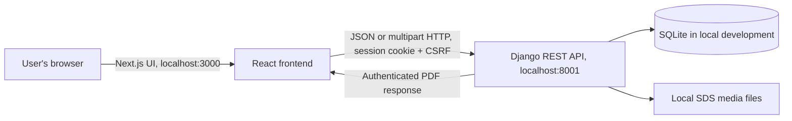

# SafeSheets Architecture

## Current system at a glance

SafeSheets is a small three-part web application. The browser renders the Next.js interface, Django REST Framework validates requests and enforces access, and SQLite stores application rows during local development. Uploaded SDS PDFs are stored under Django’s local media directory and are served only by an authenticated API view.



The planned production database in earlier project notes was PostgreSQL, but the checked-in settings currently point to SQLite. Keep SQLite for the single-developer demo. Move to PostgreSQL only when deployment or concurrent use justifies it, and then validate the migration separately without replacing local data.

## Components and responsibilities

### Frontend (`frontend/`)

Next.js App Router and React with TypeScript provide the login page and dashboard. The browser calls the configured `NEXT_PUBLIC_API_URL` (default `http://localhost:8001/api`), includes cookies with `credentials: "include"`, and obtains a CSRF token before state-changing requests. It presents chemical inventory search/filter, summary counts, chemical details, create/edit/delete forms, SDS upload/edit, and authenticated PDF viewing. The development server uses the existing Turbopack CSS setup; the production build script uses Next.js’s supported Webpack mode, which also builds without requiring an external font download.

The frontend may guide users with required fields and file size hints. It cannot be trusted to enforce permissions or file validity. Django remains authoritative. The Next.js project has ESLint and TypeScript checks; no dedicated frontend unit-test framework was present during the audit.

### Backend (`backend/`)

Django REST Framework owns validation, sessions, permissions, review-status calculation, API responses, and file delivery. Inventory and SDS APIs require an authenticated user. Login, session inspection, and CSRF initialization are separate endpoints. SessionAuthentication enforces CSRF for unsafe requests.

The API uses SessionAuthentication. CORS and CSRF trusted origins default to the two localhost frontend origins and can be configured through environment variables.

### Database and uploaded files

SQLite is located at `backend/db.sqlite3` and is ignored by Git. Django migrations define the schema. Uploaded files currently live under `backend/media/sds_documents/`; existing untracked PDFs in this working tree are user data and must be preserved. A `FileField` stores a relative name in the row. The file endpoint checks login and handles absent files with 404.

Local disk is suitable for a demo, not a horizontally scaled deployment. Production should use private object storage with access mediated by the backend or short-lived authorized links, plus backup and retention policy. Chemical deletion explicitly removes linked SDS rows and files after the database transaction commits; it cannot be undone.

## Data models as implemented

### Django User

The built-in Django user model stores username, password hash, and active/staff/superuser flags. No custom role field is defined.

### Chemical

| Field | Meaning |
|---|---|
| `id` | Database identifier |
| `name` | Required chemical/product name, max 200 characters |
| `manufacturer` | Optional manufacturer, max 200 characters |
| `location` | Optional storage location, max 200 characters |
| `notes` | Optional notes |
| `created_by` | Optional user reference; current create flow does not set it |
| `created_at`, `updated_at` | Timestamps |

### SDSDocument

| Field | Meaning |
|---|---|
| `id` | Database identifier |
| `chemical` | Required foreign key; deleting the chemical cascades its database document rows |
| `title` | Document title, max 200 characters |
| `revision_date` | Optional date from the document |
| `next_review_date` | Optional organizational review date |
| `file_reference` | Optional legacy/reference text |
| `sds_file` | Optional PDF file stored under `sds_documents/` |
| `created_at`, `updated_at` | Timestamps |

`review_status` is a computed property, not a stored column. Missing is unknown; past is overdue; today through 30 days ahead inclusive is due soon; later is current. `timezone.localdate()` is used, with Django configured to UTC. A date is a reminder only and not evidence of compliance.

### Access boundary

Authentication is required, but there is no organization foreign key or per-user queryset restriction. Any authenticated user can access the shared dataset and update records. This is acceptable only for a trusted local portfolio demo. Before multi-user or production use, define roles and organization membership, scope every queryset to the organization, and test cross-tenant denial.

## API surface in the current code

Base URL: `http://localhost:8001/api/`

| Method and path | Access | Purpose |
|---|---|---|
| `GET /health/` | Public | Basic backend health response |
| `GET /csrf-token/` | Public | Set/read CSRF cookie before browser writes |
| `POST /auth/login/` | Public + CSRF | Create a Django session from username/password |
| `GET /auth/session/` | Public | Return whether a session is active and username when signed in |
| `POST /auth/logout/` | Signed in + CSRF | End current session |
| `GET, POST /chemicals/` | Signed in | List or create chemical records |
| `GET, PUT, PATCH, DELETE /chemicals/{id}/` | Signed in | Retrieve, update, or delete; delete cascades to linked SDS metadata and files |
| `GET, POST /sds-documents/` | Signed in | List or create SDS metadata; optional `review_status` query filter |
| `GET, PATCH /sds-documents/{id}/` | Signed in | Retrieve or update SDS metadata and optionally replace its PDF |
| `GET /sds-documents/{id}/file/` | Signed in | Stream the associated PDF |

Chemical list search currently happens in the browser. SDS status filtering is also currently evaluated in Python after loading the queryset. Pagination, API search, and structured audit logs are future improvements for larger datasets.

## File validation and delivery

The SDS API response returns `sds_file: true/false` to indicate whether a file is attached; it does not return a local path. The SDS model validates a `.pdf` extension, a maximum size of 10 MiB, and the `%PDF-` header. This is a useful baseline but does not prove a PDF is safe or well-formed. Do not serve uploads through an unauthenticated static media URL. The file API uses the authenticated session and returns a PDF stream; storage paths are not returned as error detail.

## Local setup and configuration

The backend requires `DJANGO_SECRET_KEY` at startup. `backend/.env.example` documents safe placeholder values, but settings do not load that file automatically. Export a stable development-only value in your shell before starting Django; never commit the actual value and never use it in production. The frontend API origin uses `NEXT_PUBLIC_API_URL` and defaults to `http://localhost:8001/api`. Next.js embeds public environment variables at build time, so configure this value before building. Django debug mode, allowed hosts, CORS and CSRF origins are also configurable.

The documented local startup is:

```sh
DJANGO_SECRET_KEY='your-stable-local-development-secret' python backend/manage.py runserver 8001
cd frontend && npm run dev
```

Use an environment variable mechanism already trusted on your machine if you prefer not to put the value in shell history. The local database and PDFs are not disposable; do not reset them to set up the application.

## Test strategy

- Django: `DJANGO_SECRET_KEY='local-test-key' ./.venv/bin/python backend/manage.py check`
- Django tests: `DJANGO_SECRET_KEY='local-test-key' ./.venv/bin/python backend/manage.py test safety_api`
- Frontend lint: `cd frontend && npm run lint`
- Frontend types: `cd frontend && npx tsc --noEmit`

Tests should cover authentication, chemical create/retrieve/update validation, file upload validation and access, and review-date edges. Frontend verification should cover edit/cancel and submit-once behavior. Keep test-created data isolated in Django’s temporary test database; do not use the local development database for destructive test setup.

## Phased implementation plan

1. **Audit and stabilize:** preserve current changes and data; run checks; map existing endpoints and UI. Done when current behavior and failures are documented.
2. **Chemical workflow:** verify create/detail/search/filter, prefilling, `PATCH` editing, cancellation, and confirmation before cascading deletion of SDS rows/files.
3. **SDS workflow:** add and edit metadata, verify chemical association, date fields, server PDF checks, authenticated access, missing-file response, and status boundaries.
4. **Dashboard quality:** refine responsive layout, loading/empty/error/success feedback, focus/keyboard access, and terminology using real API values.
5. **Reliability/security:** test auth/CSRF and invalid inputs; define roles and ownership before any shared deployment; avoid exposing raw paths/errors.
6. **Portfolio readiness:** update setup/API/limitations documentation, record verified checks accurately, then consider screenshots and deployment as separate work.

This is intentionally scoped for one developer. PostgreSQL deployment, roles/tenant isolation, storage service, CI, end-to-end browser automation, and notifications are not required for the local MVP.
